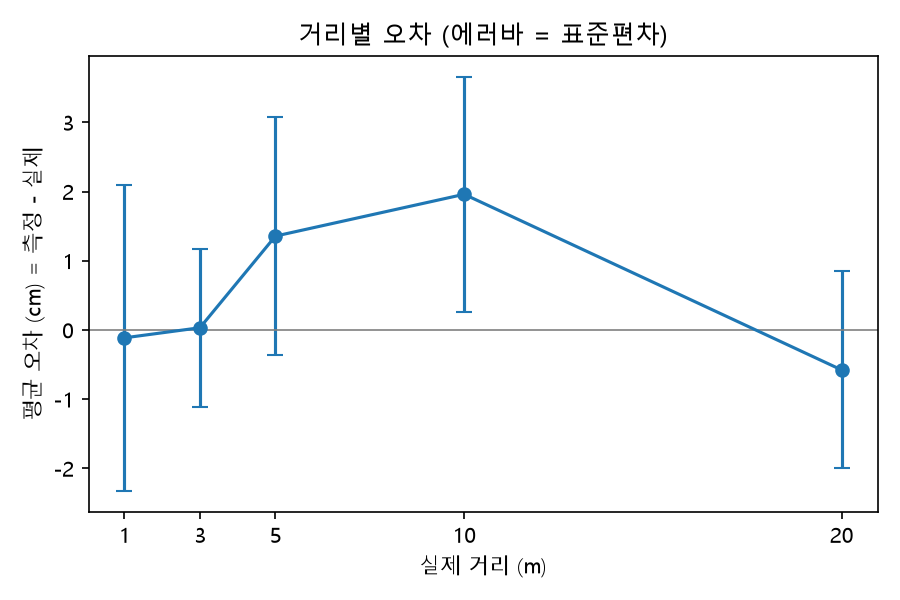

# Task 1: DWM3001CDK UWB 성능 평가

목표: 드론 앵커로 쓸 DWM3001CDK의 거리 측정 오차와 성공률을 조건별로 숫자로 확보한다.
원본 과제: `UWB · STM32N6 · BLE 과제.pdf` (2026-11-05).

## 진행 현황 (2026-11-09)

| 레벨 | 상태 | 비고 |
| --- | --- | --- |
| Lv1 동작 확인 | 완료 | 레인징, CSV 로깅, 1.00 m 300회 x 10 run, `LISTCAL` 기록 |
| Lv2 성능 측정 | 완료(조건을 줄임) | 11개 조건(거리 5, 방향 4, NLOS 2). 알루미늄과 장소 조건은 하지 않음. 아래 "PDF와 다르게 한 것" 참고 |
| Lv3 심화 | 시작 전 | |

## Lv1 체크리스트 (동작 확인)

- [x] 보드 2개 J-Link 포트(J9) 연결, Qorvo DW3 QM33 SDK 다운로드
- [x] SDK `Binaries` 폴더의 CLI 펌웨어 플래싱 (절차: SDK `Documentation/Developer Manual` 5.4.2절)
- [x] 한쪽 initiator(`INITF`), 다른 쪽 responder(`RESPF`)로 TWR 레인징, PC 시리얼에 거리 출력 확인
- [x] 로깅 스크립트로 시리얼 → CSV (timestamp, sequence_number, mac_address, status, distance_cm, success). 위치: `../common/logger/`. CLI 기본 출력에 RSSI와 first-path power가 없어서 저장하지 않음
- [x] 안테나 딜레이 보정 (아래 기록. 보정하지 않고 기본 보정값을 사용, `LISTCAL` 값 기록)
- [ ] 배치 사진 `photos/`

통과 기준 (PDF): 거리가 PC에 출력되고 CSV로 저장됨. 보정값이 README에 기록됨.

## Lv2 체크리스트 (성능 측정)

- [x] 1. 거리 1 / 3 / 5 / 10 / 20 m (LOS, 정면 마주봄)
- [ ] 2. 알루미늄(뒤) 이격 0 / 1 / 3 / 5 cm: 하지 않음. 태그(DWM3000)로 Task 2에서 측정
- [ ] 3. 알루미늄(옆) 이격 0 / 3 cm: 하지 않음
- [x] 4. 방향: 오른쪽 45°, 90°와 왼쪽 45°, 90° (PDF는 0°~315° 8개)
- [x] 5. NLOS: 사람 몸으로 가림, 콘크리트 벽 1개(25 cm)
- [ ] 6. 장소(실험실 / 복도 / 야외): 하지 않음. 학교 복도 한 곳에서 측정
- [x] 7. 분석 스크립트: `analyze.py` (조건별 평균 오차, 표준편차, 95% 절대오차, 성공률 표)
- [ ] 8. 그래프 2개: 거리별 오차 그래프 1개만 있음. 알루미늄 그래프는 알루미늄을 하지 않아 없음
- [x] 9. 결론 한두 줄: 아래 "결과 (Lv2)"
- [ ] 10. 측정 배치 사진: 없음

Lv2 조건: 조건당 500회, 보드 높이는 바닥에서 80 cm(PDF는 1 m).

## 안테나 딜레이 보정 기록

| 항목 | 값 |
| --- | --- |
| 측정 거리 | 1.00 m (두 보드의 안테나 사이) |
| 측정 횟수 | 300 x 10 run |
| 보정 전 평균 | 99.85 cm (전체 3000개, 표준편차 2.59 cm) |
| 보정값 | 보정하지 않음 (기본 보정값 사용). `LISTCAL` 값은 아래 참고 |
| 보정 후 평균 | 해당 없음 |
| 측정 날짜·장소 | 2026-11-06, 실내 |

보정하지 않은 이유: 전체 평균 오차(-0.15 cm)가 측정 잡음(표준편차 2.59 cm)과 cm 정수 출력 단위보다 작다. SDK 매뉴얼에 따르면 DWM3001CDK는 칩에 기본 보정값이 들어 있다(OTP).

`LISTCAL` 출력(2026-11-09, 레인징 중이 아닌 대기 상태). 거리 보정과 관련된 키:

| 키 | CDK 1 | CDK 2 |
| --- | --- | --- |
| `ant0.ch9.ant_delay` | `0x00003ffb` (16379) | `0x00003ffb` (16379) |
| `ant0.ch5.ant_delay` | `0x00003ff2` (16370) | `0x00003ff5` (16373) |
| `xtal_trim` | `0x19` | `0x19` |
| `ant0.ch9.ref_frame0.tx_power_index` | `0x1b1b1b1b` | `0x14141414` |
| `ant0.ch5.ref_frame0.tx_power_index` | `0x1e1e1e1e` | `0x1b1b1b1b` |

- 채널 9의 안테나 딜레이는 두 보드가 같다. 채널 5는 3 차이가 난다.
- 송신 전력 값과 `pg_count`는 두 보드가 다르다(CDK 1 `pg_count` ch5/ch9 `0xb0`/`0xb0`, CDK 2 `0xb3`/`0xb2`). 보드마다 공장에서 쓴 값이 다르다.
- `INITF` 기본값은 채널 9이므로(매뉴얼 기준) 레인징에는 `ant0.ch9.ant_delay`가 쓰였을 것으로 본다. 이번 실행의 채널은 `STAT`로 확인하지 않았다.
- 출력에서 `ant0`만 송신 전력 값과 `pg_count`가 설정되어 있고 `ant1`~`ant3`는 0이다.
- 이 값들은 보드의 OTP에서 온 기본값이다. SDK 릴리스 노트에 "OTP 값을 기본으로 쓴다"고 되어 있다.

## Lv1 데이터

| 파일 | 내용 | 상태 |
| --- | --- | --- |
| `data/t1_dist_1m_los_run1.csv` ~ `run10.csv` | 1.00 m, 300회 x 10 run raw | ☑ |
| `../common/logger/log_ranging.py` | 로깅 스크립트 | ☑ |
| `photos/` | 보드 배치 사진 | ☐ |

배치 상세: 두 보드를 벽에 붙여 놓고 1.00 m 간격으로 측정했다.

## 결과 (Lv1)

| run | 평균 (cm) | 중앙값 | 표준편차 | 최소~최대 | 평균 오차 | 빠진 측정 |
| --- | --- | --- | --- | --- | --- | --- |
| 1 | 98.93 | 99 | 2.07 | 92~105 | -1.07 | 0 |
| 2 | 98.89 | 99 | 2.26 | 90~105 | -1.11 | 0 |
| 3 | 98.76 | 99 | 2.27 | 90~105 | -1.24 | 0 |
| 4 | 98.56 | 99 | 2.53 | 90~103 | -1.44 | 0 |
| 5 | 99.10 | 99 | 2.44 | 90~105 | -0.90 | 0 |
| 6 | 99.78 | 100 | 2.42 | 91~106 | -0.22 | 1 |
| 7 | 100.54 | 100 | 2.72 | 92~107 | +0.54 | 0 |
| 8 | 100.84 | 101 | 2.39 | 91~107 | +0.84 | 0 |
| 9 | 101.42 | 101 | 2.29 | 94~107 | +1.42 | 0 |
| 10 | 101.68 | 102 | 1.87 | 96~107 | +1.68 | 1 |
| 전체 | 99.85 | 100 | 2.59 | 90~107 | -0.15 | 2 |

- 3000개 모두 `SUCCESS`.
- run 평균이 약 10분 동안 98.9에서 101.7 cm로 약 3 cm 올랐다. 원인은 확인하지 못했다.
- 결론: 기본 보정값 그대로 1.00 m에서 평균 99.85 cm, 표준편차 2.59 cm.

## 결과 (Lv2)

**측정 대상:** DWM3001CDK 두 개. 프로젝트에서 3001은 앵커용이고 태그용은 DWM3000이다. 이 결과는 앵커(3001) 기준이다.

**측정 방법**

- CDK 1(initiator, PC 연결)과 CDK 2(responder, 보조배터리 전원). 학교 복도 한 곳에서 측정했다.
- 보드 높이는 바닥에서 80 cm, 받침은 금속이 아닌 것. 두 보드를 똑바로 세워 같은 방향으로 마주 보게 하고, 안테나(보드 위쪽 돌출부의 금색 판) 사이 거리를 줄자로 맞췄다.
- 조건마다 레인징 500회(성공과 실패 모두 센 시도 횟수). 조건을 바꿀 때마다 `STOP`, `INITF`로 레인징을 새로 시작하고 터미널을 닫은 뒤 `python ../common/logger/log_ranging.py COM6 task1_uwb/data/<파일>.csv -n 500`으로 기록했다.
- 방향: 한쪽 보드(CDK 2)를 돌렸다. 오른쪽은 시계 방향, 왼쪽은 반시계 방향. 정면(0°)은 거리 3 m 결과를 기준으로 쓴다. 파일 이름의 각도는 오른쪽 45°, 90°가 `45`, `90`, 왼쪽 45°, 90°가 `315`, `270`이다. 거리는 모두 3 m.
- NLOS 사람 몸: 사람이 두 보드 사이 1.5 m 지점(정중앙)에 서서 가렸다. 3 m.
- NLOS 벽: 콘크리트 벽 1개, 두께 25 cm. 벽 두께를 포함해 3 m.

**정의**

- 성공 = `status`가 `SUCCESS`이고 거리값이 있는 행. 성공률 = 성공 행 / 전체 행(500).
- 평균 오차 = 성공 행 거리의 평균 − 실제 거리. 표준편차는 모표준편차. 95% 절대오차 = |오차|의 95번째 백분위수.
- 오차 통계는 성공 행으로 계산하고, 음수나 엉뚱한 거리도 성공으로 보고된 값이면 포함한다.

원자료: `data/` 의 조건별 CSV. 분석: `python analyze.py`(`task1_uwb/`에서 실행)가 `results/results.md`, `results/results.csv`, `results/fig_distance_error.png`를 만든다. `analyze.py`는 이름 규칙에 맞는 CSV만 읽고 Lv1의 `..._run1.csv` 같은 파일은 읽지 않는다.

| 조건 | 파일 | 실제 거리 (cm) | 측정 횟수 | 성공률 | 평균 (cm) | 평균 오차 (cm) | 표준편차 (cm) | 95% 절대오차 (cm) | 최대 (cm) |
| --- | --- | --- | --- | --- | --- | --- | --- | --- | --- |
| 거리 1 m | `t1_dist_1m_los.csv` | 100 | 500 | 100% | 99.9 | -0.1 | 2.2 | 4.0 | 107 |
| 거리 3 m | `t1_dist_3m_los.csv` | 300 | 500 | 100% | 300.0 | 0.0 | 1.1 | 2.0 | 304 |
| 거리 5 m | `t1_dist_5m_los.csv` | 500 | 500 | 100% | 501.4 | +1.4 | 1.7 | 4.0 | 506 |
| 거리 10 m | `t1_dist_10m_los.csv` | 1000 | 500 | 100% | 1002.0 | +2.0 | 1.7 | 5.0 | 1008 |
| 거리 20 m | `t1_dist_20m_los.csv` | 2000 | 500 | 100% | 1999.4 | -0.6 | 1.4 | 3.0 | 2004 |
| 방향 왼쪽 90° | `t1_angle_270deg.csv` | 300 | 500 | 98.4% | 308.1 | +8.1 | 2.7 | 12.0 | 314 |
| 방향 왼쪽 45° | `t1_angle_315deg.csv` | 300 | 500 | 98.4% | 308.7 | +8.7 | 8.1 | 23.0 | 356 |
| 방향 오른쪽 45° | `t1_angle_45deg.csv` | 300 | 500 | 100% | 304.8 | +4.8 | 1.4 | 7.0 | 311 |
| 방향 오른쪽 90° | `t1_angle_90deg.csv` | 300 | 500 | 100% | 310.5 | +10.5 | 2.8 | 15.0 | 320 |
| NLOS 사람 몸 | `t1_nlos_body.csv` | 300 | 500 | 94.8% | 328.9 | +28.9 | 17.8 | 52.4 | 364 |
| NLOS 벽 1개 (콘크리트 25 cm) | `t1_nlos_wall.csv` | 300 | 500 | 100% | 336.1 | +36.1 | 1.7 | 39.0 | 342 |

관찰:
- LOS에서는 1~20 m 모두 평균 오차가 -0.6 ~ +2.0 cm, 95% 절대오차가 2~5 cm, 성공률 100%다. 거리가 멀수록 나빠지는 경향은 보이지 않는다.
- 정면에서 벗어나면 거리가 길게 나온다. 방향 4개의 평균 오차는 모두 양수(+4.8 ~ +10.5 cm)이고 성공률은 98.4~100%다. 왼쪽 90°(+8.1)와 오른쪽 90°(+10.5)는 비슷하다. 왼쪽 45°만 표준편차가 8.1 cm로 흔들렸고, 두 번 측정했을 때 모두 오른쪽 45°(1.4 cm)보다 불안정했다. 원인은 확인하지 못했다.
- 사람이 가리면 평균 오차 +28.9 cm에 표준편차 17.8 cm, 성공률 94.8%다. 값이 시간에 따라 올랐다(100개씩 평균 312.9 → 340.9 cm).
- 콘크리트 벽 1개(25 cm)가 사이에 있으면 평균 오차 +36.1 cm인데 표준편차는 1.7 cm이고 성공률 100%다. 구간별 평균이 336.1 cm로 변하지 않는다. 일정한 편향이다. 편향이 벽 두께의 약 1.4배인데, 전파가 벽 안에서 느려져서 거리가 길게 계산된 영향일 수 있다(추정, 확인하지 않았다).

결론: 앵커(DWM3001CDK) 기준으로 LOS에서는 20 m까지 평균 오차 -0.6 ~ +2.0 cm, 성공률 100%라 위치 추정에 쓸 수 있다. 성능이 무너지는 조건은 가림이다. 사람이 가리면 +29 cm에 흔들림이 크고(표준편차 17.8 cm), 콘크리트 벽 하나가 있으면 +36 cm로 길어지며, 정면에서 ±45~90° 벗어나면 +5~10 cm 길어진다.

## 한계

측정의 한계:

- `results/results.md`의 비고에 있는 "앞 약 N행은 포트를 열기 전에 쌓인 출력"은 터미널을 닫고 로깅을 시작하기까지 쌓인 출력이다. 조건마다 레인징을 새로 시작했으므로 같은 배치의 데이터다. 최종 파일들은 `sequence_number` 누락이 0이다.
- `timestamp`는 PC가 받은 시각이다.
- 이 결과는 앵커(3001) 기준이다. 태그(3000)와 알루미늄은 측정하지 않았다.

## 빌드·플래싱

- 보드: DWM3001CDK 2개. CDK 1이 initiator(PC 연결), CDK 2가 responder.
- SDK: DW3 QM33 SDK 1.1.1의 `SDK/Binaries/DWM3001CDK/DWM3001CDK-CLI-FreeRTOS.hex`. 저장소에는 올리지 않는다(Qorvo 라이선스). 올린 펌웨어의 `STAT`는 Version 1.1.0, Build Aug 13 2025 14:23:02였다.
- 플래싱: 보드의 **J9**를 PC에 연결한다. SEGGER J-Flash Lite(V9.92)에서 장치 `NRF52833_xxAA`, 인터페이스 SWD, 속도 4000 kHz, 위 hex 선택, Program Device. 예전 펌웨어가 있으면 Erase Chip 먼저. 끝나면 USB를 뽑았다 다시 꽂는다. 보드마다 한 번씩 한다.
- 시리얼: CLI는 **J20(nRF USB)**로 나온다. J20을 PC에 연결하면 새 COM 포트가 생기고, 115200 8N1, 흐름 제어 없음으로 접속해 `HELP`가 응답하면 정상. 보드마다 J20용 케이블이 하나씩 필요하다.
- responder: CDK 2에서 `SETAPP RESPF`, `SAVE`를 입력하면 전원만 연결해도 responder로 시작한다.
- 레인징: CDK 1의 터미널에서 `INITF`. 기본값(매뉴얼 기준 채널 9, 블록 200 ms)을 썼고 이번 실행의 실제 값은 `STAT`로 확인하지 않았다. 중지는 `STOP`.
- 기록: CDK 1의 터미널을 모두 닫고(같은 COM 포트를 한 프로그램만 열 수 있다. 보드는 계속 레인징한다) `python ../common/logger/log_ranging.py COM6 t1_dist_1m_los_run1.csv -n 300`. 포트는 장치 관리자에서 확인한다. 같은 이름으로 저장하면 덮어쓰므로 run마다 이름을 바꾼다.

- Lv2 분석: `task1_uwb/`에서 `python analyze.py`(matplotlib 필요)를 실행하면 `results/`에 표와 그래프가 만들어진다. 로깅은 같은 이름의 파일이 있으면 멈추고, 덮어쓰려면 `--force`를 붙인다.

## 참고

- 포럼 보고: SDK 1.1.0, 1.1.1 CLI는 세션 파라미터만 출력하고 레인징이 안 됨. 1.0.2에서 됐다는 보고가 있음. 이번에는 1.1.1 패키지의 CLI 펌웨어로 레인징이 됐다.
- 1.1.1 예제에서 DWM3001CDK HardFault 보고 있음. 예제는 빌드하지 않아서 확인하지 않았다.
- 막힌 곳은 `../삽질기록.md`에 남긴다.
