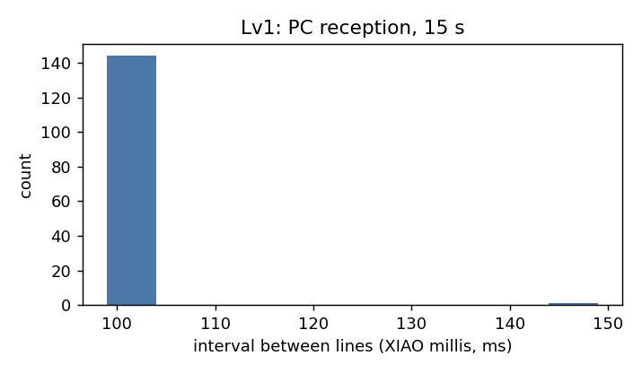

# Task 4 Lv1 결과: XIAO → 동글 → PC 수신

PDF Lv1 통과 기준: 스마트폰 수신, 동글 경유 PC 수신.

| Lv1 항목 | 결과 | 근거 |
| --- | --- | --- |
| 개발환경 선택·설치 | Arduino IDE + Seeed nRF52 Boards (동글은 nRF Connect SDK) | `../README.md` 개발환경 기록 |
| XIAO LED, USB 시리얼 | 동작 | `../xiao_blink/` |
| BLE 페리페럴(NUS), 스마트폰 수신 | `XIAO1` 연결, UART TX 알림에 `seq,millis` 값 확인 | [`../photos/t4_lv1_phone_nus.png`](../photos/t4_lv1_phone_nus.png) |
| 동글에 central 펌웨어 올리기 | Programmer로 Write, COM 포트 생성 | `../dongle_central/README.md` |
| XIAO → 동글 → PC 시리얼 수신 | `seq,millis` 줄 수신, 아래 표 | [`../data/lv1/pc_rx/t4_lv1_dongle_rx_15s.csv`](../data/lv1/pc_rx/t4_lv1_dongle_rx_15s.csv) |

스마트폰 화면의 CCCD 줄에 `Disabled`가 보이는 것은 구독하기 전에 읽은 값이다. 같은 화면의 UART TX 값은 `seq,millis` 형식이다.

## PC 수신 (15초)

방법: 동글 COM 포트를 시리얼로 15초 동안 읽어 줄 단위로 저장했다. 패킷은 `<seq>,<millis>\n`, XIAO는 약 100 ms마다 한 줄 송신 (`xiao_peripheral`).

<!-- BEGIN:table -->
| 항목 | 값 |
| --- | --- |
| 수신 줄 수 | 148 |
| seq 범위 | 86562 ~ 86709 |
| seq 끊김 | 0 |
| 줄 간격 평균 / 표준편차 (ms) | 101.0 / 7.1 |
| 줄 간격 최소 / 최대 (ms) | 99 / 150 |
<!-- END:table -->

한계: 15초 한 번만 측정했다. XIAO와 동글 사이 거리·배치는 기록하지 않았다. RC(`K32SRC_RC`) 클럭 조건에서 장시간 안정성과 끊김 후 재연결 시간은 확인하지 않았다.

결론: XIAO가 보낸 `seq,millis`가 동글을 거쳐 PC 시리얼에 끊김 없이 도착한다.
