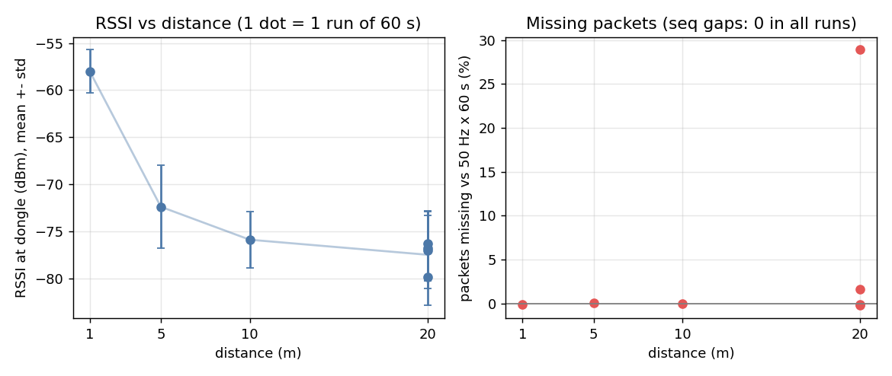

# Task 4 Lv2 결과: 거리별 RSSI와 패킷 손실

PDF: 1 / 5 / 10 / 20 m 거리에서 RSSI와 패킷 손실률을 잰다(각 1분).

## 방법

- XIAO는 보조배터리로 전원을 받고 PC와 연결하지 않는다. 동글이 연결되면 스스로 64 B 패킷을 초당 50개(50 Hz) 보낸다(`../xiao_throughput/`의 자동 모드, 연결 간격 7.5 ms 요청).
- 동글 펌웨어가 연결 RSSI를 1초에 한 번 읽어 `RSSI,<ms>,<dBm>` 줄로 USB 시리얼에 낸다(HCI Read RSSI, `CONFIG_BT_CTLR_CONN_RSSI=y`). 이 값은 동글이 XIAO에서 받은 신호의 세기다.
- PC(`../measure/distance.py`)는 동글 포트만 읽는다. Enter를 누른 뒤 3초 안정화 후 60초 동안 패킷 수, seq 끊김, RSSI를 센다.
- 거리는 동글을 기준으로 XIAO를 그만큼 띄워서 쟀다. 동글과 XIAO의 높이는 같게 했다. 장소는 실내 복도다.
- 패킷 손실은 seq 끊김으로 센다. BLE는 재전송을 하므로 약한 링크에서는 패킷이 사라지기보다 초당 도착 수가 줄어든다. 그래서 50 Hz × 60 s = 3000개 대비 수신 부족분(`부족분`)도 같이 본다.
- 원자료: [`../data/lv2/distance/`](../data/lv2/distance/) (`t4_dist_<거리>m.csv` = 초당 수신 패킷 수와 RSSI, `summary.csv`). 측정 조건 상세는 [`../MEASUREMENTS.md`](../MEASUREMENTS.md).

## 결과

<!-- BEGIN:table -->
### 거리별 요약

| 거리 | 측정 횟수 | RSSI 평균 (dBm) | 표준편차 | 최대 / 최소 (dBm) | 수신 / 기대 (성공률) | seq 끊김 | 연결 끊김 줄 |
| --- | --- | --- | --- | --- | --- | --- | --- |
| 1 m | 1회 × 60 s | -58.0 | 2.3 | -53 / -66 | 3003 / 3000 (100.1%) | 0 | 0 |
| 5 m | 1회 × 60 s | -72.4 | 4.4 | -66 / -85 | 2998 / 3000 (99.9%) | 0 | 0 |
| 10 m | 1회 × 60 s | -75.9 | 3.0 | -71 / -85 | 3000 / 3000 (100.0%) | 0 | 0 |
| 20 m | 4회 × 60 s | -77.5 | 3.8 | -70 / -88 | 11094 / 12000 (92.5%) | 0 | 0 |

### 측정 회차별

| 거리 | 회차 | 측정 시각 | 수신 / 기대 | 부족분 | RSSI 평균 (최소 ~ 최대) | 표준편차 | 원자료 |
| --- | --- | --- | --- | --- | --- | --- | --- |
| 1 m | 1 | 2026-11-09 20:08:56 | 3003 / 3000 | -0.10% | -58.0 (-66 ~ -53) | 2.3 | 원자료 CSV 있음 |
| 5 m | 1 | 2026-11-09 20:26:15 | 2998 / 3000 | 0.07% | -72.4 (-85 ~ -66) | 4.4 | 원자료 CSV 있음 |
| 10 m | 1 | 2026-11-09 20:20:25 | 3000 / 3000 | 0.00% | -75.9 (-85 ~ -71) | 3.0 | 원자료 CSV 있음 |
| 20 m | 1 | 2026-11-09 20:23:11 | 2133 / 3000 | 28.90% | -79.9 (-86 ~ -74) | 3.0 | 요약만 (CSV는 재측정으로 덮어씀) |
| 20 m | 2 | 2026-11-09 20:35:16 | 3004 / 3000 | -0.13% | -76.8 (-85 ~ -72) | 3.5 | 요약만 (CSV는 재측정으로 덮어씀) |
| 20 m | 3 | 2026-11-09 20:36:27 | 2950 / 3000 | 1.67% | -76.3 (-84 ~ -71) | 3.5 | 요약만 (CSV는 재측정으로 덮어씀) |
| 20 m | 4 | 2026-11-09 20:38:18 | 3007 / 3000 | -0.23% | -77.0 (-88 ~ -70) | 4.1 | 원자료 CSV 있음 |
<!-- END:table -->

## 관찰

- 1 / 5 / 10 m는 3000개를 거의 다 받았다(부족분 0.1% 이하). seq 끊김과 연결 끊김은 모든 측정에서 0이었다.
- 20 m는 같은 위치에서 4번 쟀다. 첫 측정은 2133 / 3000(부족분 28.9%)이었고, 그 뒤 3번은 3004 / 2950 / 3007로 정상이었다. 첫 측정은 초당 수신이 8~87개로 크게 흔들렸다. 원인은 확인하지 못했다. 재측정 때 배치가 완전히 같았는지도 기록하지 않았다.
- 20 m에서 RSSI 평균은 4번 모두 -76 ~ -80 dBm이었고, 첫(나쁜) 측정과 나머지의 평균 차이는 약 3 dB였다. RSSI 평균만으로는 28.9% 부족을 설명하지 못한다.
- RSSI는 거리가 늘수록 낮아졌다(1 m -58, 5 m -72, 10 m -76, 20 m -77.5 dBm). 5 m와 10 m의 차이는 3.5 dB로 작다. 측정 순서는 1 → 10 → 20 → 5 → 20(재측정)이었다. 복도 반사나 간섭의 영향으로 보이지만 확인하지 않았다.

## 한계

- 거리마다 1회(20 m만 4회) 측정했다. 20 m 첫 측정의 초당 원자료 CSV는 재측정으로 덮어써져서 `summary.csv`의 요약만 남았다.
- XIAO가 보낸 총 개수를 알 수 없어서, 측정 구간 끝에서 잃은 패킷은 셀 수 없다. 대신 3000개 기준 부족분을 같이 보였다.
- 거리를 줄자로 쟀다는 것 외에 기준점(안테나 위치)의 오차, 동글을 PC에 어떻게 꽂았는지, 주변 2.4 GHz 환경(Wi-Fi 등)은 기록하지 않았다. 배치 사진도 없다.
- RSSI는 동글 쪽 값만 있다. XIAO가 받는 RSSI는 재지 않았다.
- 한 장소(실내 복도)의 결과다. 드론 비행 환경(실내 공간, 모터 구동 중)과는 다르다.

## 결론

실내 복도에서 1 / 5 / 10 m는 50 Hz × 64 B를 손실 없이 보냈고, 20 m는 4번 중 3번 정상이었지만 1번은 28.9% 부족했다. 20 m(RSSI 약 -77 dBm)는 안정적으로 쓸 수 있는 거리의 끝 근처로 보는 것이 안전하다.
