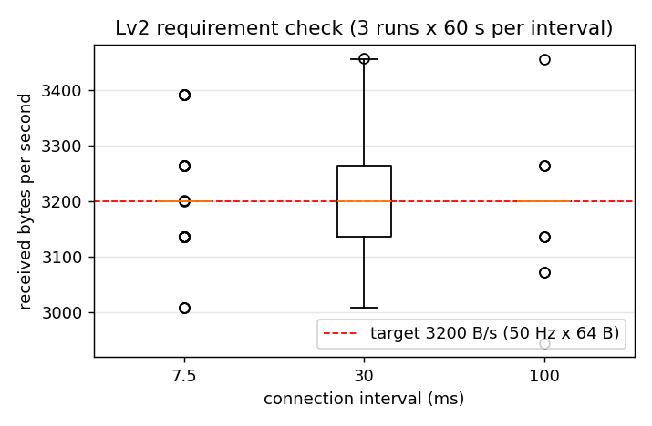

# Task 4 Lv2 결과: 드론 요구치 비교 (50 Hz × 64 B)

PDF: 드론 요구치와 비교. 예: 50 Hz × 64 B = 3.2 kB/s를 손실 없이 보낼 수 있는지.

## 방법

- 처리량 측정과 같은 스케치·스크립트에서 송신 속도를 지정한다(`CFG 64 <간격> 50`, 스크립트 `--rate 50`). 패킷 64 B를 초당 50개 보낸다.
- 연결 간격 7.5 / 30 / 100 ms, 조건마다 60초, 3회 반복. 성공은 손실 0.
- 원자료: [`../data/lv2/rate_check/`](../data/lv2/rate_check/) (`t4_rate50_len64_ci<간격>ms_r<회차>.csv` = 초당 수신 bytes, `summary.csv`). 측정 조건 상세는 [`../MEASUREMENTS.md`](../MEASUREMENTS.md).

## 결과

<!-- BEGIN:table -->
| 연결 간격 | 측정 횟수 | 보낸 패킷 | 받은 패킷 | 성공률 | 수신 평균 | 초당 최소 / 최대 (B/s) |
| --- | --- | --- | --- | --- | --- | --- |
| 7.5 ms | 3회 × 60 s | 9005 | 9005 | 100.00% (손실 0) | 3201.4 B/s | 3008 / 3392 |
| 30 ms | 3회 × 60 s | 9005 | 9005 | 100.00% (손실 0) | 3201.4 B/s | 3007 / 3457 |
| 100 ms | 3회 × 60 s | 9003 | 9003 | 100.00% (손실 0) | 3198.6 B/s | 2944 / 3456 |
<!-- END:table -->

## 관찰

- 9회 모두 보낸 패킷을 전부 받았고 seq 끊김과 깨진 줄도 없었다.
- 초당 수신량은 1초 안에 도착한 패킷 수 × 64 B라서 64 B 단위(예: 3008, 3072, 3136, 3200)로만 나온다. 그래서 위 그래프가 계단처럼 보인다. 목표(3200 B/s) 둘레로 흔들린다. 알림이 연결 이벤트 단위로 묶여 도착하기 때문으로 보이며 손실과는 다르다(이 해석은 확인하지 않았다).

## 한계

- 포화 측정과 같은 거리에서 측정했고 XIAO와 동글 사이 거리·배치는 기록하지 않았다. 거리가 멀어질 때의 손실은 Lv2 거리별 측정에서 따로 본다.
- 조건당 60초씩 3회다.

## 결론

50 Hz × 64 B(3.2 kB/s)는 연결 간격 7.5 / 30 / 100 ms에서 모두 손실 없이 전송됐다.
