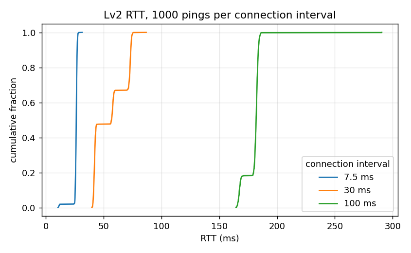

# Task 4 Lv2 결과: 왕복 지연 (RTT)

PDF: PC → 동글 → XIAO → 에코 → PC, 1,000회 평균·최대.

## 방법

- 경로: PC → 동글(USB 시리얼) → BLE(NUS RX 쓰기) → XIAO → 에코(NUS TX 알림) → 동글 → PC.
- PC(`../measure/rtt.py`)가 64 B 줄 `<번호>,xxxx…\n`을 한 번에 하나씩 보내고, 같은 번호의 줄이 돌아올 때까지의 시간을 `perf_counter`로 잰다. 응답이 1초 안에 안 오면 손실로 세고 RTT 통계에서는 뺀다.
- XIAO는 `../xiao_throughput/`의 에코 기능(받은 바이트를 그대로 되돌림)을 쓴다.
- 연결 간격 7.5 / 30 / 100 ms, 조건마다 1,000회.
- 원자료: [`../data/lv2/rtt/`](../data/lv2/rtt/) (`t4_rtt_len64_ci<간격>ms.csv` = 번호별 RTT, 빈 칸은 손실, `summary.csv`). 측정 조건 상세는 [`../MEASUREMENTS.md`](../MEASUREMENTS.md).

## 결과

<!-- BEGIN:table -->
| 연결 간격 | 측정 횟수 | 평균 (ms) | 표준편차 | 최대 | 최소 | 중앙값 | 95% | 성공률 |
| --- | --- | --- | --- | --- | --- | --- | --- | --- |
| 7.5 ms | 1000 | 26.0 | 2.1 | 31.4 | 10.6 | 26.3 | 27.3 | 100% |
| 30 ms | 1000 | 55.3 | 13.8 | 86.8 | 39.9 | 56.8 | 73.9 | 100% |
| 100 ms | 1000 | 179.8 | 7.7 | 290.6 | 164.5 | 181.9 | 184.5 | 100% |
<!-- END:table -->

## 관찰

- 30 ms와 100 ms에서 평균 RTT는 연결 간격의 약 1.8배다. 쓰기와 에코 알림이 각각 다음 연결 이벤트를 기다리기 때문으로 보인다(확인하지 않은 해석).
- 7.5 ms에서는 평균이 2 × 간격(15 ms)보다 약 10 ms 크다. 이 고정 지연이 PC 시리얼·USB 경로인지 동글 펌웨어인지는 구분하지 못했다.
- RTT 분포가 계단 모양이다(30 ms에서 약 41 / 58 / 73 ms 부근에 몰림, 위 그래프). 계단의 원인은 확인하지 않았다.
- 1,000회 모두 응답이 왔다(손실 0).

## 한계

- 측정값에는 PC 시리얼 스택과 USB 경로 시간이 들어 있어서 무선 구간만의 지연이 아니다.
- 조건당 1회 측정이고, XIAO와 동글 사이 거리·배치는 기록하지 않았다. 거리가 멀어질 때의 RTT는 보지 않았다.

## 결론

이 링크의 왕복 지연은 연결 간격이 지배한다. 7.5 ms에서 평균 약 26 ms, 100 ms에서 약 180 ms이고, 모든 조건에서 응답을 잃지 않았다.
