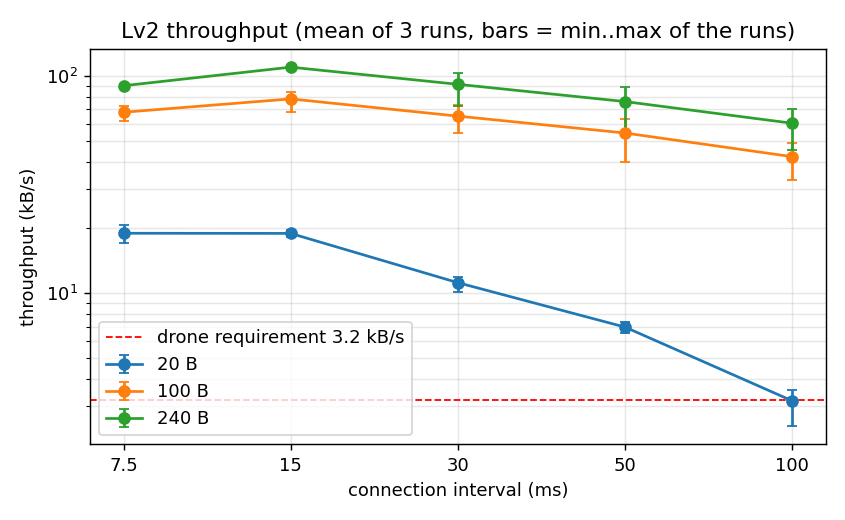
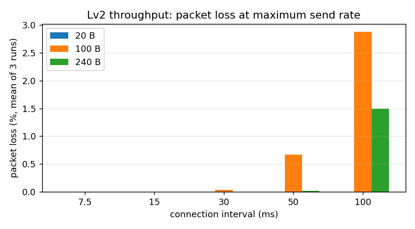

# Task 4 Lv2 결과: 처리량

PDF: 최대 몇 bytes/s까지 보낼 수 있는지 (패킷 크기, connection interval을 바꿔가며). 조건 값과 반복 횟수는 PDF에 없어서 직접 정했다.

## 방법

- XIAO(`../xiao_throughput/`)가 쉬지 않고 최대 속도로 송신하고, PC(`../measure/throughput.py`)가 동글(`central_uart`) USB 시리얼로 받은 bytes를 센다.
- 조건: 패킷 20 / 100 / 240 B × 연결 간격 7.5 / 15 / 30 / 50 / 100 ms, 조건마다 30초, 3회 반복(초 단위 값 90개).
- 패킷은 `seq,millis,xxxx…\n` 전체 길이 기준. 처리량은 앱 계층 bytes/s(패딩과 개행 포함). 손실률은 XIAO가 보낸 패킷 수와 PC가 받은 고유 seq 수의 차이.
- XIAO는 연결 간격만 요청하고 MTU 247, PHY, 데이터 길이는 동글과 자동 협상된다(전 조건 `mtu=247`, 실제 연결 간격이 요청값과 일치).
- 원자료: [`../data/lv2/throughput/`](../data/lv2/throughput/) (`t4_tp_len<패킷>_ci<간격>ms_r<회차>.csv` = 초당 수신 bytes, `summary.csv` = 회차별 패킷 수·손실). 측정 조건 상세는 [`../MEASUREMENTS.md`](../MEASUREMENTS.md).

## 결과

표의 평균·표준편차·최대는 3회 × 30초의 초 단위 값 90개 기준, "회차별 평균"은 1/2/3회차 값이다.

<!-- BEGIN:table -->
| 패킷 | 연결 간격 | 측정 횟수 | 평균 (kB/s) | 표준편차 | 최대 | 회차별 평균 | 성공률 |
| --- | --- | --- | --- | --- | --- | --- | --- |
| 20 B | 7.5 ms | 3회 × 30 s | 18.8 | 2.2 | 21.5 | 18.9 / 17.0 / 20.5 | 100.00% (손실 평균 0.00%, 최대 0%) |
| 20 B | 15 ms | 3회 × 30 s | 18.8 | 1.6 | 22.8 | 18.1 / 19.5 / 18.8 | 100.00% (손실 평균 0.00%, 최대 0%) |
| 20 B | 30 ms | 3회 × 30 s | 11.1 | 2.5 | 20.8 | 11.4 / 11.9 / 10.1 | 100.00% (손실 평균 0.00%, 최대 0%) |
| 20 B | 50 ms | 3회 × 30 s | 7.0 | 1.4 | 12.0 | 6.5 / 7.0 / 7.3 | 100.00% (손실 평균 0.00%, 최대 0%) |
| 20 B | 100 ms | 3회 × 30 s | 3.2 | 1.1 | 6.2 | 2.4 / 3.5 / 3.6 | 100.00% (손실 평균 0.00%, 최대 0%) |
| 100 B | 7.5 ms | 3회 × 30 s | 67.9 | 6.8 | 77.0 | 69.4 / 61.8 / 72.5 | 100.00% (손실 평균 0.00%, 최대 0%) |
| 100 B | 15 ms | 3회 × 30 s | 78.2 | 10.0 | 90.1 | 67.8 / 83.1 / 83.8 | 100.00% (손실 평균 0.00%, 최대 0%) |
| 100 B | 30 ms | 3회 × 30 s | 65.2 | 13.7 | 87.8 | 54.4 / 67.8 / 73.3 | 99.96% (손실 평균 0.04%, 최대 0.12%) |
| 100 B | 50 ms | 3회 × 30 s | 54.5 | 16.6 | 83.0 | 40.0 / 60.4 / 63.0 | 99.33% (손실 평균 0.67%, 최대 0.84%) |
| 100 B | 100 ms | 3회 × 30 s | 42.4 | 14.7 | 72.1 | 33.1 / 44.9 / 49.2 | 97.12% (손실 평균 2.88%, 최대 4.84%) |
| 240 B | 7.5 ms | 3회 × 30 s | 89.9 | 3.9 | 98.2 | 88.7 / 91.6 / 89.5 | 100.00% (손실 평균 0.00%, 최대 0%) |
| 240 B | 15 ms | 3회 × 30 s | 109.5 | 4.5 | 118.8 | 108.8 / 109.5 / 110.2 | 100.00% (손실 평균 0.00%, 최대 0%) |
| 240 B | 30 ms | 3회 × 30 s | 91.3 | 18.3 | 122.9 | 72.5 / 98.4 / 103.0 | 100.00% (손실 평균 0.00%, 최대 0%) |
| 240 B | 50 ms | 3회 × 30 s | 76.0 | 21.4 | 118.8 | 53.1 / 85.9 / 89.1 | 99.98% (손실 평균 0.02%, 최대 0.07%) |
| 240 B | 100 ms | 3회 × 30 s | 60.4 | 21.1 | 100.0 | 45.3 / 65.8 / 70.2 | 98.50% (손실 평균 1.50%, 최대 2.07%) |
<!-- END:table -->

## 관찰

- 가장 높은 값은 240 B·15 ms의 약 109.5 kB/s이고 회차별 값이 거의 같아 재현성이 좋다.
- 7.5 ms가 15 ms보다 낮은 것(240 B)은 3회 모두 같게 나와 우연이 아니다. 원인은 확인하지 않았다.
- 연결 간격 30 ms 이상에서는 회차 간 차이가 크다. 1회차가 2·3회차보다 낮았고, 모든 회차를 같은 순서로 측정해서 첫 회차 효과인지 환경 영향인지는 구분하지 못했다.
- 손실은 연결 간격이 긴 조건(100 ms·100 B, 100 ms·240 B, 50 ms·100 B)에서 3회 모두 나왔고 나머지는 거의 0%다. 동글 쪽 버퍼 때문인지 링크 때문인지는 확인하지 않았다.
- 드론 요구치 3.2 kB/s(50 Hz × 64 B)와 비교하면 20 B·100 ms의 평균이 같은 수준이고 나머지 조건은 모두 더 높다.

## 한계

- 쉬지 않고 최대 속도로 보낸 포화 측정이다. 고정 속도에서의 무손실 여부는 [`lv2_rate_check.md`](lv2_rate_check.md)에서 따로 본다.
- XIAO와 동글 사이 거리·배치, 주변 2.4 GHz 환경은 기록하지 않았다.

## 결론

연결 간격 7.5~100 ms, 패킷 20~240 B 전 조건에서 3.2 kB/s 이상의 평균 처리량이 나왔고(최저 20 B·100 ms가 요구치와 같은 수준), 최고는 240 B·15 ms의 약 109.5 kB/s다. 연결 간격이 길수록 손실이 생기는 조건이 있다.
